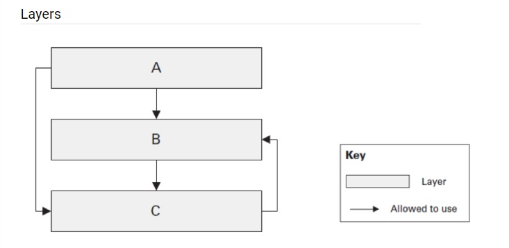

_Questions for the self-check:_

1. Name examples of the layered architecture. Do they differ or just extend each other?
2. Is the below layered architecture correct and why? Is it possible from C to use B? from A to use C?
   
3. Is DDD a type of layered architecture? What is Anemic model? Is it really an antipattern?
4. What are architectural anti-patterns? Discuss at least three, think of any on your current or previous projects.
5. What do Testability, Extensibility and Scalability NFRs mean. How would you ensure you reached them? Does Clean Architecture cover these NFRs?

ANSWERS

1. Three layer, n-layer, onion, clean architecture are types of layered architectures. They extend each other but also differs. By adding new layers responsibilities are separated. Also for onion and clean direction of depency is changed. So, these are not sipmly architectures with more layers.

2. It does not seemed correct. Dependencies between B and C creates circular dependency. And dependency between A and C decreases maintainabilty. When C is modified it might introduce extra modifications for both A and B libraries.

3. DDD is a concepto to model software according to the busines rules and concepts. Layered architecture can be used together with it but DDD does not have to use layers. Anemic model is the object with data, getters and setters which is passed to busines service. It might be considered as anti-pattern for complex models. But sometimes this is easy to use and can be a good choice.

4. Anemic Domain Model, Golden Hammer, Big Ball of Mud
Anemic Domain Model: Domain objects hold data while business logic lives in services.
Golden Hammer: Apply a technology/architecture to every problem without considering suitability.
Big Ball of Mud: Structures, modules and responsibilities are not clear.

5. Testability: Determines how easy to test business logic independently. You need to seperate busines logic from infrastructure to achive this. You can ensure it by testing business rules without needing external systems like database, payment provider etc.

Extensibility: Ease of adding new features etc. without dramatic changes defines the level of extensibility. We need to utilize explicit interfaces and encapsulation to isolate changes. If we can add new feauture with minimal effort and not touching other business logic we might consider it done.

Scalability: Ability to handle increasing demand. To ensure it we can run load test on an enviroment similar to production to see errors, bottle necks and latency etc.

Clean architecture supports first two but scaleability needs suitable deployment, scaling and data strategies.

